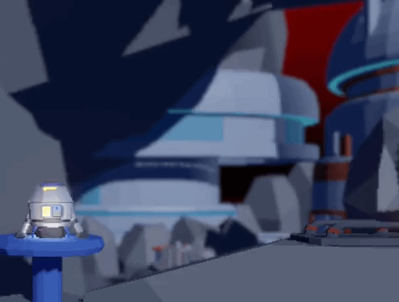

# 🚀 Rocket Booster

Launch your rocket from one landing pad, thread it through a field of obstacles, and land safely on the other side.



## 🎮 About the Game

Rocket Booster is a 3D-looking, 2D-movement rocket game built with Unity. You rotate the rocket with the arrow keys and hit thrust to fly in the direction it's facing, taking off from the landing pad on the left and aiming for the pad on the right. Along the way you'll face:

- ⛰️ Rocks
- 🛰️ A space base
- ⚙️ Pistons moving up and down
- 💥 Crystals that pop out of the ground to say hello (and destroy your rocket)
- 🌑 One very dark level

## 🗺️ Levels

The game has 3 levels. The first one is a calm warm-up. The second one looks almost the same, so you might think you've seen it all. You haven't. The third one turns the lights off.

## 🕹️ Controls

| Key | Action |
|-----|--------|
| Space | Thrust (the rocket flies in the direction it's facing) |
| ⬅️ Left Arrow | Rotate left |
| ➡️ Right Arrow | Rotate right |
| Esc | Quit the game (Windows version only) |

## ▶️ Play

- **Play in your browser:** [nisyaa.github.io/rocketbooster](https://nisyaa.github.io/rocketbooster/) *(desktop browser only, keyboard required)*
- **Download:** [Releases page](../../releases)

## 🛠️ Built With

- Unity (Universal Render Pipeline)
- C#

## 🧰 Run From Source

1. Install Unity **6000.5.1f1** (via Unity Hub).
2. Clone this repository:
   ```bash
   git clone https://github.com/nisyaa/rocketbooster.git
   ```
3. Open the project folder in Unity Hub and open the main scene.
4. Press Play.

## 💡 Development Notes

- This is my first Unity game, built step by step while learning.

## 🙏 Credits

- Models and audio come from the game development course I took. Code and level design are my own.

## 👩‍💻 Author

**Aysin**
GitHub: [@nisyaa](https://github.com/nisyaa)
